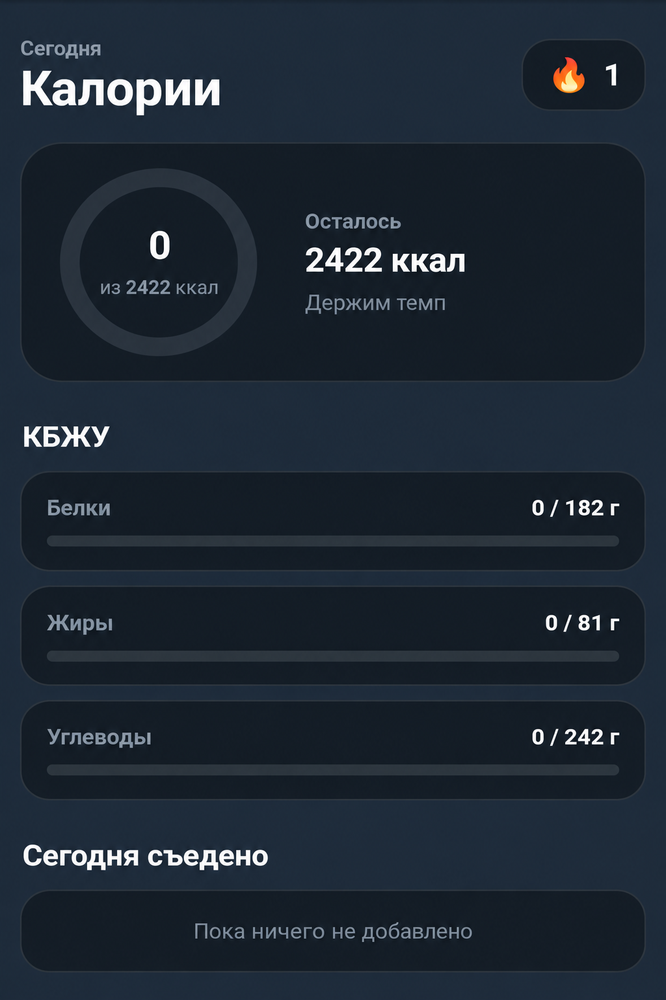
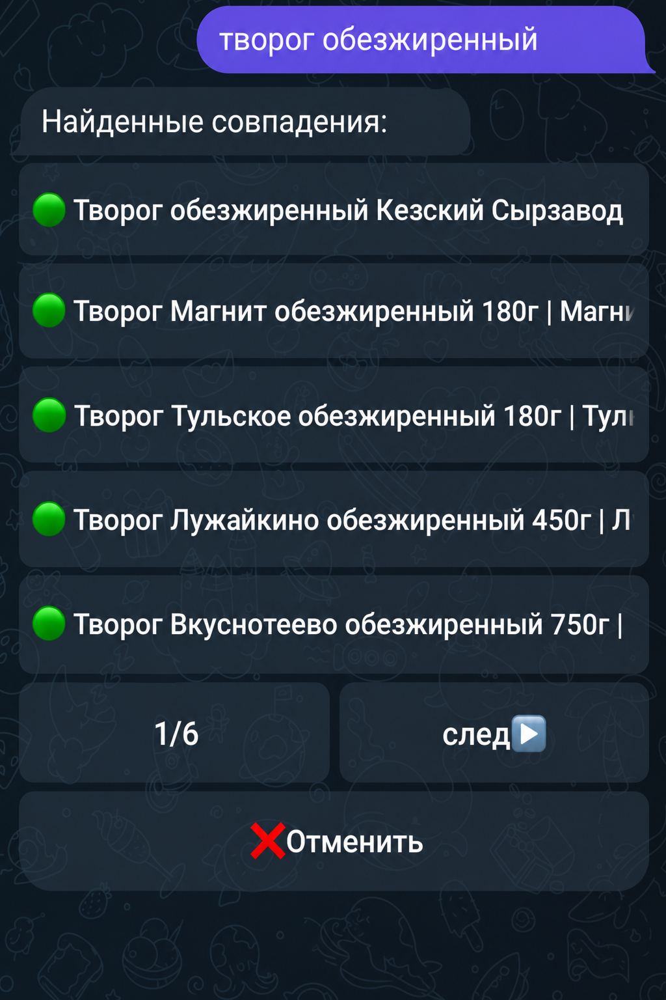
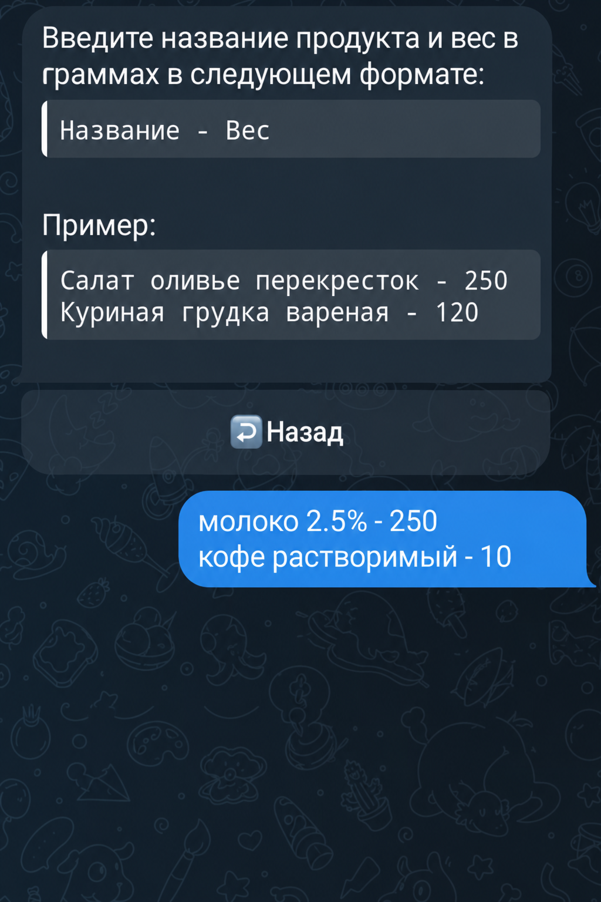
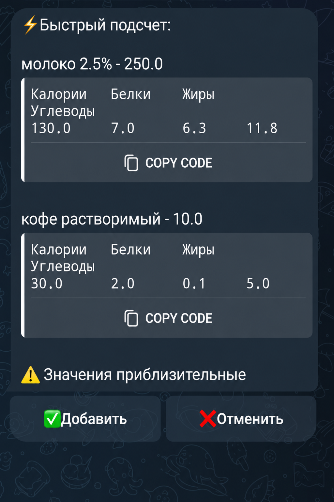

# Calorie Counter Bot

Telegram-бот с Mini App для ведения дневника питания, подсчёта калорий и КБЖУ.

Проект позволяет рассчитывать дневную норму, добавлять съеденные продукты разными способами, отслеживать остаток калорий, просматривать историю питания и пользоваться отдельным интерфейсом Telegram Mini App.



## Возможности

- Расчёт дневной нормы калорий и КБЖУ
- Учёт съеденной еды за день
- Расчёт оставшихся калорий, белков, жиров и углеводов
- Добавление собственных блюд
- Сохранение часто используемых продуктов
- Поиск продуктов по локальной базе
- Добавление еды через быстрый AI-подсчёт
- Удаление добавленных продуктов
- История питания за последние 7 дней
- Серия активных дней — streak
- Telegram Mini App с отдельным интерфейсом
- Недельная статистика калорий

## Расчёт дневной нормы КБЖУ

Для расчёта базового обмена веществ используется формула:

$$
BMR = 10 \times W + 6.25 \times H - 5 \times A + S
$$

где:

- $W$ — вес в килограммах;
- $H$ — рост в сантиметрах;
- $A$ — возраст в годах;
- $S$ — коэффициент пола.

Коэффициент пола:

$$
S =
\begin{cases}
5, & \text{для мужчин} \\
-161, & \text{для женщин}
\end{cases}
$$

После расчёта BMR результат умножается на коэффициент физической активности:

| Уровень активности | Коэффициент |
|---|---:|
| Сидячий образ жизни | 1.2 |
| Лёгкая активность | 1.375 |
| Умеренная активность | 1.55 |
| Высокая активность | 1.725 |

Суточная потребность в калориях рассчитывается по формуле:

$$
TDEE = BMR \times K_{activity}
$$

После этого применяется поправка в зависимости от выбранной цели:

| Цель | Изменение калорийности |
|---|---:|
| Снижение веса | -15% |
| Поддержание веса | 0% |
| Увеличение веса | +12% |

Итоговая суточная норма:

$$
K_{daily} =
TDEE \times
\dfrac{100 + K_{goal}}{100}
$$

где $K_{goal}$ принимает значения `-15`, `0` или `12`.

### Распределение БЖУ

Соотношение белков, жиров и углеводов зависит от выбранной цели:

| Цель | Белки | Жиры | Углеводы |
|---|---:|---:|---:|
| Снижение веса | 30% | 30% | 40% |
| Поддержание веса | 25% | 30% | 45% |
| Увеличение веса | 25% | 25% | 50% |

Для перевода калорий в граммы используются значения:

$$
1\text{ г белка} = 4\text{ ккал}
$$

$$
1\text{ г жира} = 9\text{ ккал}
$$

$$
1\text{ г углеводов} = 4\text{ ккал}
$$

Количество белков рассчитывается как:

$$
Protein =
\dfrac{K_{daily} \times P_{protein}}
{100 \times 4}
$$

Количество жиров:

$$
Fat =
\dfrac{K_{daily} \times P_{fat}}
{100 \times 9}
$$

Количество углеводов:

$$
Carbs =
\dfrac{K_{daily} \times P_{carbs}}
{100 \times 4}
$$

где $P_{protein}$, $P_{fat}$ и $P_{carbs}$ — процентные значения из таблицы выше в зависимости от выбранной цели.

## Поиск продуктов

Для поиска используется локальная база `products.db`, содержащая продукты из нескольких источников:

1. Magnit
2. Lenta
3. USDA

Если подходящий продукт не найден в локальной базе, выполняется fallback-поиск через Perek API.

Локальный поиск построен на SQLite FTS5 и дополнительно использует собственное ранжирование результатов.

Приоритет источников при близкой релевантности:

```text
Magnit → Lenta → USDA → Perek
```



Поиск поддерживает пагинацию и не ограничивается первыми несколькими десятками найденных продуктов.

## Telegram Mini App

Помимо обычного интерфейса Telegram-бота, проект содержит Mini App.

В Mini App можно:

- посмотреть съеденные и оставшиеся калории;
- посмотреть дневную норму КБЖУ;
- увидеть текущий streak;
- посмотреть статистику калорий за последние 7 дней;
- посмотреть список съеденной сегодня еды;
- удалить продукт из дневника;
- добавить сохранённый продукт;
- найти продукт в общей базе;
- добавить продукт вручную;
- воспользоваться быстрым AI-подсчётом.

## Быстрый AI-подсчёт

Для приблизительного расчёта КБЖУ используется Gemini API.

Пользователь может передать сразу несколько продуктов с указанным весом, после чего бот получает приблизительные значения:

```text
Калории
Белки
Жиры
Углеводы
```




После подтверждения рассчитанные продукты добавляются в дневник.

## Используемые технологии

### Backend

- Python 3.11
- aiogram
- FastAPI
- Uvicorn
- aiohttp
- aiosqlite

### Database

- SQLite
- SQLite FTS5

Используются две основные базы данных:

```text
calorie_bot.db
```

Пользовательские данные, дневник питания, сохранённые блюда, дневные нормы и streak.

```text
data/products.db
```

Локальная база продуктов для поиска.

### Frontend

- HTML
- CSS
- JavaScript
- Telegram Web Apps API

### External APIs

- Gemini API
- Perek API
- Telegram Bot API

## Структура проекта

```text
calorie_bot/
├── handlers/
│   ├── ai_food.py
│   ├── commands.py
│   ├── custom_food.py
│   ├── daily_allowance.py
│   ├── delete_food.py
│   ├── fallback.py
│   ├── food_history.py
│   ├── menus.py
│   ├── product_search.py
│   └── saved_food.py
│
├── services/
│   ├── gemini.py
│   ├── perek.py
│   └── telegram_auth.py
│
├── data/
│   └── products.db
│
├── web/
│   ├── index.html
│   ├── style.css
│   └── app.js
│
├── api.py
├── config.py
├── database.py
├── keyboards.py
├── main.py
├── maintenance.py
├── run.py
├── states.py
├── requirements.txt
├── .env.example
├── .gitignore
└── README.md
```

### `handlers/`

Обработчики команд, callback-запросов и FSM-состояний Telegram-бота.

### `services/`

Работа с внешними сервисами и API.

### `database.py`

Работа с SQLite, дневником питания, пользовательскими данными и поиском продуктов.

### `api.py`

FastAPI backend для Telegram Mini App.

### `web/`

Frontend Mini App.

### `run.py`

Общий запуск Telegram-бота и FastAPI.

## License

Проект распространяется по лицензии **MIT**.

Подробности находятся в файле [LICENSE](LICENSE).